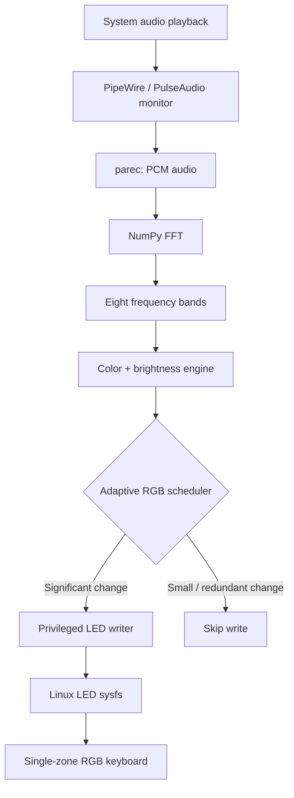

<div align="center">

# G5 KE Music RGB

**Make your keyboard follow the music.**

An audio-reactive, single-zone RGB keyboard visualizer for Linux, built and tested on the **GIGABYTE G5 KE**.

[](#requirements)
[](#requirements)
[](#compatibility)
[](#compatibility)

**[Quick start](#quick-start) · [How it works](#how-it-works) · [Compatibility](#compatibility) · [Troubleshooting](docs/TROUBLESHOOTING.md) · [Español](docs/GUIA_ES.md)**

</div>

> [!IMPORTANT]
> **Hardware-specific project.** This is a tested research build, **not a universal keyboard driver**. It requires an existing, compatible Linux LED interface. Do not install random kernel modules or write EC registers to make it work.

## What does it do?

G5 KE Music RGB listens to audio already playing on your Linux system and changes the **whole keyboard's** color and brightness according to the music. It uses eight frequency bands and an adaptive scheduler that avoids needless hardware writes.

| Feature | Implementation |
| :-- | :-- |
| Audio capture | PulseAudio-compatible monitor, via `parec` (typically provided by PipeWire) |
| Music processing | Python + NumPy FFT; eight spectral bands |
| Visual output | RGB color and global brightness |
| Hardware output | `/sys/class/leds/rgb:kbd_backlight/` |
| Scheduler | Reacts quickly to significant changes; skips redundant updates |
| Test mode | `--dry-run` analyzes audio without writing to LEDs |
| Exit | `Ctrl+C`; normal-exit restoration is implemented in the tested build |

### What it looks like

**Demo wanted:** a short video or GIF of the keyboard reacting to a song would help visitors understand the result. We intentionally do not include a fabricated preview. Contributions are welcome; see [Contributing](CONTRIBUTING.md).

## Quick start

These instructions target **Fedora Workstation 45**, the tested platform. The required kernel LED driver must **already** be installed and working.

**1. Install userspace dependencies** from Fedora repositories:

```bash
sudo dnf install git python3 python3-numpy pulseaudio-utils
```

**2. Clone:**

```bash
git clone https://github.com/JofreTiconaPlata/g5-ke-music-rgb.git
cd g5-ke-music-rgb
```

**3. Check that the keyboard LED interface exists:**

```bash
LED=/sys/class/leds/rgb:kbd_backlight
test -r "$LED/multi_intensity" && test -r "$LED/brightness" && echo "RGB interface found"
cat "$LED/multi_intensity"
cat "$LED/brightness"
```

If this fails, **stop** and read [Hardware compatibility](docs/HARDWARE.md). Do not assume your laptop supports this interface.

**4. Check the audio monitor:**

```bash
pactl list short sources
```

The stable build was tested with `alsa_output.pci-0000_00_1f.3.analog-stereo.monitor`. **The source name is machine-specific:** check the monitor configured in `music_rgb.py` and adapt it for your machine if necessary. See [Audio setup](docs/INSTALL.md#audio-monitor-selection).

**5. Test audio analysis without keyboard writes:**

```bash
python3 music_rgb.py --dry-run --seconds 15
```

Play music. You should see changing RMS and RGB values.

**6. Start the music-reactive keyboard:**

```bash
python3 music_rgb.py --seconds 60
```

To keep it running, omit `--seconds 60`. Stop with **Ctrl+C**.

> [!CAUTION]
> The program launches a **privileged LED writer** via `sudo`. Read [Security](docs/SECURITY.md) before running. Do **not** run the whole audio application as root or grant world-writable permissions to LED sysfs.

## How it works



The FFT analysis and the RGB write frequency are **not the same thing**. The analyzer typically runs around 21.5 analyses/s; the adaptive scheduler sends fewer hardware commands. Read [Architecture](docs/ARCHITECTURE.md).

## Measured results

These are **observations on one G5 KE**, not universal performance or battery-life guarantees.

| Trial | Analysis rate | RGB commands/s | Commands skipped |
| :-- | --: | --: | --: |
| V3.3 — 180 s | 21.52 Hz | 10.57 | 50.90% |
| V3.3 — final 60 s | 21.50 Hz | 10.83 | 49.65% |

The older fixed-schedule build (V3.2) sent about 21.19 RGB commands/s. Measurements were gathered during different music sessions and should not be read as a controlled power benchmark. More in [Benchmarks](docs/BENCHMARKS.md).

## Compatibility

| Component | Verified setup |
| :-- | :-- |
| Laptop | **GIGABYTE G5 KE** |
| CPU / dGPU | Intel Core i5-12500H / NVIDIA RTX 3060 Laptop |
| OS | Fedora Workstation 45 |
| Lighting | One-zone RGB keyboard |
| LED interface | `rgb:kbd_backlight/multi_intensity`, `brightness` |
| Driver family | Existing TUXEDO / Clevo-compatible kernel modules |

**Other GIGABYTE, Clevo and TUXEDO laptops are untested.** A similar keyboard, model name or EC does not prove compatibility. See [Hardware](docs/HARDWARE.md).

## Documentation

| Guide | What you'll find |
| :-- | :-- |
| [Install & configure](docs/INSTALL.md) | Fedora packages, audio monitor, safety checks, first run |
| [Architecture](docs/ARCHITECTURE.md) | Audio pipeline, FFT, scheduling and hardware boundaries |
| [Hardware](docs/HARDWARE.md) | Tested model, sysfs requirements, compatibility limits |
| [Troubleshooting](docs/TROUBLESHOOTING.md) | No audio, no LEDs, sudo, missing sysfs, safe diagnostics |
| [Benchmarks](docs/BENCHMARKS.md) | Reproducible observations and measurement limitations |
| [Seguir en español](docs/GUIA_ES.md) | Guía rápida en español |
| [Security](docs/SECURITY.md) | Privileged writer and responsible operation |
| [Contributing](CONTRIBUTING.md) | Issues, test reports and pull requests |

## Project status and roadmap

**Current baseline:** the tested **V3.3 algorithm**, shipped as `music_rgb.py`. The first Git commit is `2ba2a19`. We have **not declared a tagged v1.0.0 release**.

Planned improvements, **not yet available**:

- Auto-detect the audio monitor without manual configuration.
- Explicit hardware compatibility checks before invoking `sudo`.
- Unit tests for the color engine and adaptive scheduler.
- An optional unprivileged frontend with a narrowly scoped LED write mechanism.
- Repeated, controlled battery-power measurements.

## Attribution and license

This is an independent community experiment, **not affiliated with GIGABYTE or TUXEDO Computers**. G-Helper was consulted as a *conceptual reference* during development; equivalence or source-code reuse is **not claimed**.

**No open-source license has been assigned yet.** Until code provenance and third-party license compatibility are reviewed, please do not assume redistribution/modification rights beyond those provided by applicable law. See [Contributing](CONTRIBUTING.md).

## Automatic audio monitor detection

The application automatically selects the monitor associated
with the default system audio output.

No manual configuration is required on supported systems.

### Check your hardware

Run the preflight diagnostic before starting the RGB effect:

    python3 preflight.py

List available audio monitors:

    python3 preflight.py --list-monitors

### Run with automatic selection

    python3 music_rgb.py

### Select a monitor manually

Replace MONITOR_NAME with one of the detected audio monitors:

    python3 music_rgb.py --monitor MONITOR_NAME

### Test without changing keyboard lighting

    python3 music_rgb.py --dry-run --seconds 15

If several monitors are available and the default output
cannot be identified, the program may require explicit
selection.

The preflight diagnostic reads hardware and audio
information without modifying the keyboard.
